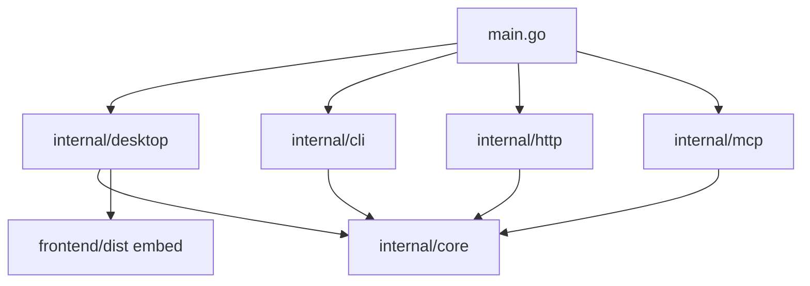
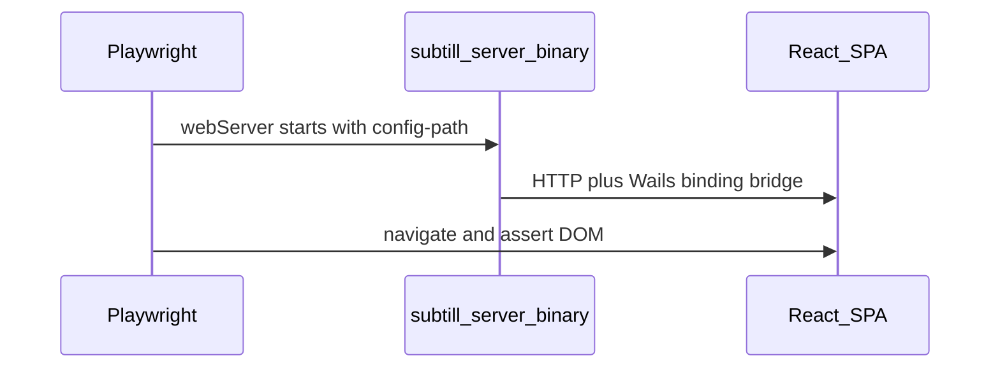

# Subtill scaffolding bootstrap

**Module:** `github.com/skarabasakis/subtill`  
**Brief:** [docs/20261013-project-brief.md](docs/20261013-project-brief.md)  
**Versions:** [`.tool-versions`](.tool-versions) (Go 1.25.4, Node 24.20.0)

## Architecture (scaffold)



- **Modes (mutually exclusive):** default → Wails desktop; or `--cmd`, `--mcp`, `--api`. Error if more than one adapter flag.
- **`--api`:** JSON routes + Swagger at `/api/docs` only (no React SPA).
- **Desktop UI:** single Vite build → `frontend/dist` → [`frontend/embed.go`](frontend/embed.go) → Wails only. TanStack Query default query fn → Wails bindings.
- **Core:** `internal/core` (domain, service stubs, sqlx + `modernc.org/sqlite`, migrations in `internal/core/migrate/migrations/`).
- **Tasks:** All developer workflows live in [`Taskfile.yml`](Taskfile.yml); invoke via **`wails3 task <name>`** (no standalone `task` CLI). [`.vscode/tasks.json`](.vscode/tasks.json) is thin wrappers that only run `wails3 task …`.
- **Desktop E2E:** Playwright against Wails **server mode** (`-tags server`) — same SPA + bindings as desktop, no native window ([brief](docs/20261013-project-brief.md)). Isolated app state via **`--config-path`** (temp dir per run).



## Tooling

| Tool | Install | Use |
|------|---------|-----|
| golangci-lint v2 | Binary on PATH (e.g. brew; pin v2.15.0 in README) | `golangci-lint run`, `golangci-lint fmt`; [`.golangci.yml`](.golangci.yml) with `version: "2"` + `formatters` |
| swag v2 | `go get -tool github.com/swaggo/swag/v2/cmd/swag@v2.0.0-rc6` | `go tool swag init --v3.1` via `//go:generate` in `internal/http/doc.go` |
| wails3 | PATH | `wails3 task dev`, `wails3 task build`, … |
| Frontend | npm in `frontend/` | oxlint, oxfmt, vitest |
| Desktop E2E | npm in `e2e/` | `@playwright/test`; `npx playwright install chromium` |

Custom tasks in [`Taskfile.yml`](Taskfile.yml): `lint`, `fmt`, `test`, `test:integration`, `e2e`, `openapi` (names via `wails3 task -list`). CI and terminal use the same entrypoints.

## `go:embed` rules

- UI: `frontend/embed.go` → `//go:embed all:dist` (not from `internal/`).
- SQL: `internal/core/migrate/migrations/` embedded from `migrate` package only (not repo-root `migrations/`).

## Target layout

```
subtill/
├── main.go
├── go.mod / go.sum
├── Taskfile.yml, build/
├── internal/
│   ├── core/{domain,service,store,migrate/migrations/}
│   ├── cli/{app.go,commands/}
│   ├── http/{doc.go,server.go,routes.go,handlers/,docs/}
│   ├── mcp/server.go
│   └── desktop/{app.go,services/}
├── frontend/
│   ├── embed.go, index.html, vite.config.ts (base './')
│   ├── src/{main.tsx,app/,components/ui/,components/primitives/,lib/query/,test/}
│   └── bindings/   # generated
├── e2e/
│   ├── package.json
│   ├── playwright.config.ts   # webServer: server binary + --config-path
│   └── tests/smoke.spec.ts
├── .vscode/{extensions.json,settings.json,tasks.json}
├── .golangci.yml, .editorconfig, .gitignore
├── AGENTS.md, README.md, docs/
```

## Phase 1 — Prerequisites

```bash
asdf install
go version          # >= 1.24
node --version
wails3 version
wails3 task -list
golangci-lint version
```

## Phase 2 — Wails init + merge

```bash
tmpdir=$(mktemp -d)
wails3 init -d "$tmpdir" -n subtill -t react \
  -mod github.com/skarabasakis/subtill \
  -productname subtill \
  -productdescription "Local subscription manager" \
  -q

REPO_ROOT="$(git rev-parse --show-toplevel)"
cd "$REPO_ROOT"
rsync -av \
  --exclude 'docs/' \
  --exclude 'AGENTS.md' \
  --exclude '.git/' \
  --exclude '.cursor/' \
  --exclude '.tool-versions' \
  "$tmpdir/subtill/" "$REPO_ROOT/"
rm -rf "$tmpdir"
```

Then:

1. `main.go`: mode dispatch; desktop → `internal/desktop.Run()`.
2. Remove demo GreetService; wire `internal/desktop` + stub Wails services.
3. [`frontend/embed.go`](frontend/embed.go): `//go:embed all:dist`; pass `frontend.Dist` to desktop only.
4. Migrations under `internal/core/migrate/migrations/` with embed in `migrate.go`.
5. Merge `.gitignore` (keep `frontend/dist`, `bin/`, `node_modules` ignored).
6. [`build/config.yml`](build/config.yml): `info.productName` = `subtill` if needed.

**Go deps:**

```bash
go get github.com/jmoiron/sqlx \
  github.com/golang-migrate/migrate/v4 \
  github.com/golang-migrate/migrate/v4/database/sqlite \
  github.com/modelcontextprotocol/go-sdk/mcp \
  modernc.org/sqlite \
  github.com/swaggo/http-swagger/v2@v2.0.3-0.20250902111949-1340604bd9f5
go get -tool github.com/swaggo/swag/v2/cmd/swag@v2.0.0-rc6
go mod tidy
```

**OpenAPI (stub `GET /api/health` + pipeline):**

```bash
# internal/http/doc.go: metadata + //go:generate go tool swag init --v3.1 -g doc.go -o docs ...
go generate ./internal/http/...
```

- Import generated `internal/http/docs` package; mount `http-swagger/v2` at `/api/docs`.
- `go test`: health, `/api/docs`, spec contains `openapi` 3.1.0.

```bash
cd frontend && npm install
```

## Phase 3 — Frontend scaffold

1. React 19 (per brief).
2. `npx shadcn@latest init` + sample `button`; `src/components/primitives/` + one-line README for `ui/` vs `primitives/`.
3. `react-router` (HashRouter), `@tanstack/react-query`, `@tanstack/react-form`, `@tanstack/react-table`, `recharts`, `lucide-react`.
4. `main.tsx`: providers + placeholder db-gate under `src/app/`; `default-query-fn.ts` → bindings.
5. Add stable **`data-testid`** on the root shell / db-gate (e.g. `data-testid="app-shell"`) for Playwright smoke.
6. Dev: `oxlint`, `oxfmt`, `vitest` + one primitive component test.
7. `npm run build` → `frontend/dist` for embed.

## Phase 3b — Playwright desktop E2E

Per brief: build with **`-tags server`**, run with **`--config-path`**. After Wails merge, confirm server task/binary names via `wails3 task -list` (typical: `build:server`, output under `build/bin/`).

```bash
mkdir -p e2e && cd e2e
npm init -y
npm install -D @playwright/test
npx playwright install chromium
```

**`e2e/playwright.config.ts`**

- `testDir: './tests'`
- Prefer **`wails3 task e2e`** as the single entry (Taskfile builds server if needed, runs Playwright). If Playwright `webServer` must start the app itself, add a dedicated Taskfile task (e.g. `e2e:server`) and call it from `playwright.config.ts`—still no raw shell duplication outside Taskfile.
- `baseURL`: URL printed by Wails server mode (pin in config after first manual run; often `http://127.0.0.1:<port>`).
- `workers: 1` if tests share resources; reuse `config-path` per worker via env.
- `timeout` generous for cold Go binary start.

**`e2e/tests/smoke.spec.ts`**

- Load `/` (or hash route); expect `data-testid="app-shell"` visible.
- No product flows in bootstrap—only proves server mode + UI + Playwright wiring.

**`.gitignore`:** `e2e/test-results/`, `e2e/playwright-report/`, `e2e/node_modules/`.

**Bootstrap follow-up:** document exact `webServer.command`, binary path, and default port in README after first green run.

## Phase 4 — Taskfile + VS Code

After Wails merge, inspect how [`Taskfile.yml`](Taskfile.yml) includes `build/` tasks—add **subtill** tasks in the root file (or the project’s established include) without breaking upstream Wails targets.

| `wails3 task` | Implementation (repo root `dir:`) |
|---------------|-------------------------------------|
| `lint` | `golangci-lint run ./...`; `cd frontend && npm run lint` |
| `fmt` | `golangci-lint fmt ./...`; `cd frontend && npm run fmt` |
| `test` | `go test ./...`; `cd frontend && npm run test:run` |
| `test:integration` | `go test ./internal/http/... ./internal/mcp/...` |
| `openapi` | `go generate ./internal/http/...` |
| `e2e` | `deps`: template `build:server` (or equivalent); `cd e2e && npx playwright test` |

Optional composite: `check` → `lint`, `test`, `test:integration` (add only if useful).

Illustrative Taskfile fragment:

```yaml
  lint:
    dir: .
    cmds:
      - golangci-lint run ./...
      - cd frontend && npm run lint
  e2e:
    dir: .
    deps: [build:server]   # use actual Wails task name from wails3 task -list
    cmds:
      - cd e2e && npx playwright test
```

**[`.vscode/tasks.json`](.vscode/tasks.json)** — every subtill label delegates to Taskfile:

| VS Code label | Command |
|---------------|---------|
| `subtill: lint` | `wails3 task lint` |
| `subtill: fmt` | `wails3 task fmt` |
| `subtill: test` | `wails3 task test` |
| `subtill: test (integration)` | `wails3 task test:integration` |
| `subtill: e2e` | `wails3 task e2e` |
| `subtill: openapi` | `wails3 task openapi` |
| `subtill: dev` | `wails3 task dev` |
| `subtill: build` | `wails3 task build` |

Use `"options": { "cwd": "${workspaceFolder}" }`. Do not embed golangci/npm/go commands in `tasks.json`.

## Phase 5 — `.golangci.yml` + skeleton tests

v2 config: linters (`govet`, `staticcheck`, `errcheck`, `unused`, `gosec`); formatters (`gofmt`, `goimports`); exclude `frontend/bindings`, `internal/http/docs`.

Skeleton tests: `internal/core` (trivial); `internal/http` (health, docs, OpenAPI 3.1); `internal/mcp` (compile/smoke).

## Phase 6 — VS Code

**[`.vscode/extensions.json`](.vscode/extensions.json)** — `recommendations` and `unwantedRecommendations`:

| ID | Role |
|----|------|
| `golang.go` | Go / gopls |
| `golangci.golangci-lint` | golangci-lint |
| `wailsapp.wails` | Wails |
| `bradlc.vscode-tailwindcss` | Tailwind / shadcn |
| `oxc.oxc-vscode` | Oxlint + Oxfmt (primary JS/TS lint/format) |
| `vitest.explorer` | Vitest |
| `ms-playwright.playwright` | Desktop E2E (server mode) |
| `editorconfig.editorconfig` | EditorConfig |
| `redhat.vscode-yaml` | YAML (OpenAPI specs, configs) |
| `42crunch.vscode-openapi` | OpenAPI editing / validation |
| `qwtel.sqlite-viewer` | SQLite DB inspection |
| `github.vscode-github-actions` | GitHub Actions workflows |
| `GARAIOAG.garaio-vscode-unwanted-recommendations` | Workspace unwanted-extension hints |

**`unwantedRecommendations`** (avoid conflicting with Oxc): `dbaeumer.vscode-eslint`, `esbenp.prettier-vscode`.

Example shape:

```json
{
  "recommendations": [
    "golang.go",
    "golangci.golangci-lint",
    "wailsapp.wails",
    "bradlc.vscode-tailwindcss",
    "oxc.oxc-vscode",
    "vitest.explorer",
    "ms-playwright.playwright",
    "editorconfig.editorconfig",
    "redhat.vscode-yaml",
    "42crunch.vscode-openapi",
    "qwtel.sqlite-viewer",
    "github.vscode-github-actions",
    "GARAIOAG.garaio-vscode-unwanted-recommendations"
  ],
  "unwantedRecommendations": [
    "dbaeumer.vscode-eslint",
    "esbenp.prettier-vscode"
  ]
}
```

**[`.vscode/settings.json`](.vscode/settings.json):** `go.testTags: server`; `eslint.enable: false` (belt-and-suspenders with unwanted list); Tailwind `cn()` regex; `typescript.tsdk` → `frontend/node_modules/typescript/lib`.

## Phase 7 — AGENTS.md (add)

- Layout: logic in `internal/core`; adapters `cli`, `http`, `mcp`, `desktop`.
- Developer workflows: **`wails3 task <name>`** via [`Taskfile.yml`](Taskfile.yml). Extend Taskfile when adding lint/test/e2e steps; keep `.vscode/tasks.json` as `wails3 task` wrappers only.
- golangci-lint on PATH; `go tool swag` with `--v3.1`; commit `internal/http/docs/`.
- Frontend: desktop only; shadcn `components/ui/`; custom `components/primitives/`; Query → bindings.
- Migrations only in `internal/core/migrate/migrations/`.
- SQLite: `modernc.org/sqlite` + sqlx.
- Regenerate bindings after Wails service changes; never edit `frontend/bindings/`.
- E2E: Playwright in `e2e/` only; targets **server mode** binary, not `--api` REST. Prefer `data-testid` over CSS classes. Native dialogs / single-instance: Go tests or manual QA, not Playwright.

## Phase 8 — README

Cover: what subtill is; prerequisites; setup (`wails3 task install:frontend:deps`, `cd e2e && npx playwright install chromium` once); **`wails3 task -list`**; run modes; **all quality commands via Taskfile** (`wails3 task lint`, `test`, `e2e`, …); layout; stack notes.

## Phase 9 — Verification

```bash
wails3 task install:frontend:deps
cd e2e && npx playwright install chromium   # once

wails3 task lint
wails3 task test
wails3 task test:integration
wails3 task openapi
wails3 task build
wails3 task e2e

# REST smoke (not a Taskfile task unless you add e.g. api:smoke later)
go build -o bin/subtill . && subtill --api --port 8000 --token test &
# curl /api/health, /api/docs, spec

wails3 task dev   # optional manual
```

Document binary output path after first `wails3 task build` in README.

## Out of scope (bootstrap)

Subscription features, full CLI-parity REST/MCP routes, release CI, rich E2E product flows beyond smoke.
