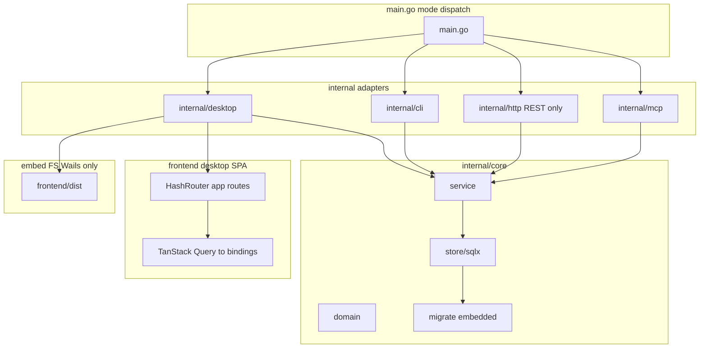

# Subtill project scaffolding and bootstrap

## Context

The repo today is docs-only ([`docs/20261013-project-brief.md`](docs/20261013-project-brief.md), [`AGENTS.md`](AGENTS.md), [`.tool-versions`](.tool-versions): Go 1.25.4, Node 24.20.0). Stack and interfaces: Go core + SQLite/sqlx/migrate, adapters for CLI/MCP/**REST API** (`--api`), Wails3 **desktop GUI only** (no browser-hosted product UI), React/Tailwind/shadcn with TanStack Query mapping query keys to **Wails bindings**.

**Chosen conventions:** Go module `github.com/skarabasakis/subtill`; Wails [Taskfile](https://taskfile.dev) via **`wails3 task <name>`** (no standalone `task` CLI); subtill lint/test/format/openapi workflows in **`.vscode/tasks.json`** (manual, bootstrap once). **No Playwright** — brief E2E (Wails `-tags server` + `--config-path`) is out of bootstrap scope.

**Brief alignment note:** REST mode flag is **`--api`** (section title); example blocks in the brief may still say `--http` — implement **`--api`** only. [`internal/http`](internal/http) serves **API routes + Swagger**; it does **not** serve the React SPA.

### Go dev tools (locked decision)

Requires **Go 1.24+** (repo uses **1.25.4** via asdf) for the **`tool`** directive on **swag** only.

| Tool | How pinned | Invoke |
|------|------------|--------|
| **golangci-lint v2** | **Official binary on `PATH`** ([local install](https://golangci-lint.run/docs/welcome/install/local/)) — **not** `go.mod` `tool`, **not** `go install`, **not** a separate `tools/go.mod` | `golangci-lint run ./...`, `golangci-lint fmt ./...` |
| **swag v2** | Root [`go.mod`](go.mod) **`tool`** directive (no `tools.go`, no `tools/go.mod`) | `go tool swag init --v3.1 ...` (v1 only emits Swagger 2.0) |

**Why binary for golangci-lint:** upstream [strongly recommends](https://golangci-lint.run/docs/welcome/install/local/) prebuilt binaries over `go tool` / `go install` because golangci-lint’s dependency graph is huge and can perturb the app module via MVS if co-located in `go.mod`.

**golangci-lint v2 only:** v1 module path `github.com/golangci/golangci-lint/cmd/golangci-lint` is obsolete; configs need **`version: "2"`** and **`formatters`** for `gofmt` / `goimports` ([migration guide](https://golangci-lint.run/docs/product/migration-guide/)).

**Target linter version (document in README):** e.g. **v2.15.0** at bootstrap time. Install examples:

```bash
# macOS (Homebrew — preferred locally per upstream)
brew install golangci-lint
golangci-lint version   # expect v2.x

# Linux / CI / pin exact version (official install script)
curl -sSfL https://golangci-lint.run/install.sh | sh -s -- -b "$(go env GOPATH)/bin" v2.15.0
```

Pin **swag** in `go.mod` during scaffold (example):

```bash
go get -tool github.com/swaggo/swag/v2/cmd/swag@v2.0.0-rc6
```

`//go:generate` in `internal/http/doc.go` must pass **`--v3.1`** and invoke **`go tool swag`** (not a global `swag` on PATH, not swag v1).

**Not pinned via `go.mod` `tool`:** **`wails3`**, **`golangci-lint`** — both are **`PATH`** prerequisites (`go install …/wails3@…` or existing setup for Wails). Optional future: `tool` + `go tool wails3` if Taskfiles are updated ([Wails #5031](https://github.com/wailsapp/wails/issues/5031)).

### SQLite stack (locked decision)

| Layer | Choice |
|-------|--------|
| API | `database/sql` (stdlib) |
| Ergonomics | [`github.com/jmoiron/sqlx`](https://github.com/jmoiron/sqlx) — extends `database/sql` with named queries, struct scanning, etc.; **driver-agnostic** (any driver that registers with `database/sql`) |
| SQLite driver | **`modernc.org/sqlite`** (pure Go) — blank import `_ "modernc.org/sqlite"` registers driver name `sqlite` |

**CGO (why this matters):** CGO lets Go call C code. Drivers like `mattn/go-sqlite3` wrap the native SQLite C library, so builds need a C toolchain and platform-specific SQLite when cross-compiling (Wails releases for Windows/macOS/Linux). **`modernc.org/sqlite` reimplements SQLite in Go** (`CGO_ENABLED=0` friendly), which fits local desktop apps and CI cross-builds with fewer moving parts. Tradeoff: different engine than system SQLite (behavior is very close for app use; edge cases exist for exotic SQL).

**Not using `mattn/go-sqlite3` unless we revisit:** only if we explicitly need linked-system-SQLite semantics or hit a modernc limitation.

**Scaffolding wiring:**

- `internal/core/store` (or `migrate`): `sqlx.Open("sqlite", "file:"+path+"?_pragma=foreign_keys(1)")` after `_ "modernc.org/sqlite"`.
- `golang-migrate` via `database/sql` + `migrate/v4/database/sqlite` with the same driver import (no mattn).
- README: one short subsection under **Stack** documenting pure-Go SQLite and `CGO_ENABLED=0` default for builds.

**sqlx vs raw `database/sql`:** The brief specifies sqlx; scaffolding uses sqlx on top of stdlib `database/sql`. You could use only `database/sql`; sqlx does not replace the driver—you still pick `modernc` or `mattn` and open with driver name `sqlite`.

### REST API / OpenAPI (locked decision)

Per [project brief](docs/20261013-project-brief.md): **`subtill --api`** exposes a REST API **documented with OpenAPI 3.1**; interactive **Swagger** at **`http://127.0.0.1:<port>/api/docs`**. **No embedded React UI** in API mode — only JSON handlers + Swagger (desktop GUI is Wails-only).

| Concern | Approach |
|---------|----------|
| Router | `net/http` + `ServeMux` (stdlib), handlers under `internal/http/` |
| Spec generation | **Code-first:** [swag **v2**](https://github.com/swaggo/swag/tree/v2) annotations on handlers; **`swag init --v3.1`** generates **OpenAPI 3.1** (`openapi.json` / `openapi.yaml` under `internal/http/docs/`) |
| OpenAPI version | **swag v1.x cannot satisfy the brief** (Swagger 2.0 only; no flag for 3.1). **v2 + `--v3.1`** is required; integration test asserts `"openapi": "3.1.0"` in the served spec |
| Security in spec | v2 security annotations (e.g. bearer / `@securityDefinitions` per v2 docs) matching `--token` / `SUBTILL_TOKEN` |
| Serving docs | [`github.com/swaggo/http-swagger/v2`](https://github.com/swaggo/http-swagger) (not v1 `http-swagger`) at **`/api/docs`**, pointing at the generated spec URL (e.g. `/api/openapi.json` — confirm filename from first `swag init --v3.1` run). Pin **`http-swagger/v2`** to a version with OpenAPI 3.1 UI support (e.g. `v2.0.3-0.20250902111949-1340604bd9f5` or newer; avoid stale `v2.0.2` + `swag/v2` mismatches per [issue #132](https://github.com/swaggo/http-swagger/issues/132)) |
| Regeneration | `//go:generate go tool swag init --v3.1 …` in `internal/http/doc.go`; VS Code **`subtill: openapi`** → `go generate ./internal/http/...`; commit `internal/http/docs/` (including generated `docs.go` importing `github.com/swaggo/swag/v2`) |
| Bootstrap scope | Stub routes only (e.g. `GET /api/health`) with full pipeline wired; **no** subscription/CLI-parity routes yet |
| Future alignment | Request/response types should eventually match Wails binding DTOs (brief); note in AGENTS—shared types in `internal/core` or `internal/api` when features land |

**Not chosen:** spec-only oapi-codegen-first (no route codegen in scaffold), Huma/Fuego (would replace mux patterns).

---

## High-level architecture



**Mode flags (mutually exclusive):** parse in `main.go` (or tiny `internal/runtime` helper); if more than one of `--cmd`, `--mcp`, `--api` is set, print error and exit non-zero. Default (no adapter flag) → desktop/Wails. **Same `subtill` binary** for all modes per [project brief](docs/20261013-project-brief.md).

**Wails integration:** Keep Wails-generated [`build/`](build/) tree and root [`Taskfile.yml`](Taskfile.yml). Thin [`main.go`](main.go) at repo root (bindings workflow). UI FS from [`frontend/embed.go`](frontend/embed.go) (`//go:embed all:dist`) is consumed **only** by [`internal/desktop`](internal/desktop) — **not** by the REST adapter. Do not embed from `internal/` (see `go:embed` path rules below). Services delegate to `internal/core` (stubs only in scaffolding).

### Desktop frontend (single SPA, Wails-only)

Per brief: the **desktop GUI** is the only product UI. There is no browser-hosted web app.

| Concern | Approach |
|---------|----------|
| Production JS/CSS | **Single** Vite production build → `frontend/dist` |
| Go embed | [`frontend/embed.go`](frontend/embed.go) (`//go:embed all:dist`) → **Wails/desktop only**; REST `--api` mode does **not** mount static SPA |
| Routing | `HashRouter` in `main.tsx`; routes under `src/app/` (e.g. db gate / placeholder shell) — **no** `app/web` vs `app/desktop` split |
| Data | TanStack Query **default query function** maps query keys to **generated Wails bindings**; native/app actions (file dialogs, recent DBs, `--config-path` state) call bindings **outside** Query per brief |
| Vite | `base: './'` for Wails webview asset paths |
| Testing | **Vitest** for components/hooks (mock bindings); **Go integration tests** for REST/MCP adapters; **desktop E2E** per brief (Wails server mode) — **not** scaffolded here (no Playwright) |

---

## Directory structure (target)

```
subtill/
├── main.go                          # mode dispatch only
├── go.mod / go.sum
├── Taskfile.yml                     # Wails upstream tasks only (no subtill lint/e2e targets)
├── build/                           # Wails platform assets (from init)
├── internal/
│   ├── core/
│   │   ├── domain/                  # Subscription, Cycle, Reminder types (structs only)
│   │   ├── service/                 # App service interfaces + no-op/stub impl returning "not implemented"
│   │   ├── store/                   # sqlx DB wrapper skeleton; Open(path) runs migrations hook
│   │   └── migrate/
│   │       ├── migrate.go           # golang-migrate driver; //go:embed migrations/*.sql
│   │       └── migrations/          # SQL files (v0 placeholder); must live under this package
│   ├── cli/
│   │   ├── app.go                   # --cmd entry, global flags (--db, --output)
│   │   └── commands/                # one file per command; stub handlers
│   ├── http/                          # REST adapter for --api (package name http; no product UI)
│   │   ├── doc.go                     # swag v2 API metadata + //go:generate go tool swag init --v3.1 ...
│   │   ├── server.go                # 127.0.0.1 listener (--bind), bearer middleware stub
│   │   ├── routes.go                # mux; /api/* JSON handlers; /api/docs → Swagger only
│   │   ├── handlers/                # HTTP handlers with swag annotations (stubs)
│   │   └── docs/                    # swag v2 output (openapi.json/yaml, docs.go); OpenAPI 3.1 via --v3.1
│   ├── mcp/
│   │   └── server.go                # stdio MCP server skeleton (register stub tools)
│   └── desktop/
│       ├── app.go                   # application.New, single-instance, window; uses shared embed FS
│       └── services/                # Wails-bound services (stubs)
├── frontend/
│   ├── embed.go                     # package frontend; //go:embed all:dist → Wails/desktop only
│   ├── index.html
│   ├── src/
│   │   ├── main.tsx                 # HashRouter + QueryClientProvider
│   │   ├── app/                     # routes, layouts, screens (db gate placeholder)
│   │   │   └── components/        # optional route-level composites
│   │   ├── components/
│   │   │   ├── ui/                  # shadcn CLI only — do not hand-add custom components here
│   │   │   └── primitives/          # app-owned reusable React + Tailwind (compose with @/components/ui)
│   │   ├── lib/
│   │   │   ├── query/client.ts      # QueryClient + provider
│   │   │   ├── query/default-query-fn.ts  # maps query keys → Wails bindings
│   │   │   └── api/query-keys.ts    # empty key map stub
│   │   └── test/setup.ts            # vitest + jsdom; mock bindings module
│   ├── bindings/                    # wails3 generate bindings (generated)
│   ├── vite.config.ts               # single config; base './'; outDir dist
│   ├── package.json
│   ├── tsconfig.json
│   ├── oxlint.json / .oxfmtrc.json  # tool configs
│   └── vitest.config.ts
├── .vscode/
│   ├── extensions.json
│   ├── settings.json
│   └── tasks.json                   # subtill dev workflows (manual maintenance; bootstrap once)
├── .golangci.yml
├── .editorconfig
├── .gitignore                       # merge Wails + node + bin/
├── AGENTS.md                        # expanded rules
├── README.md                        # build/run/test
└── docs/                            # unchanged
```

### `go:embed` constraints (layout rule)

[`embed`](https://pkg.go.dev/embed) paths are relative to the **`.go` file’s package directory**; `..` is not allowed. Therefore:

- **Do not** use `internal/assets` with `//go:embed all:frontend/dist` (would require crossing out of `internal/assets`).
- **Do not** use repo-root `migrations/` with `//go:embed` in `internal/core/migrate` (same issue).
- **Do** embed built UI from [`frontend/embed.go`](frontend/embed.go) (`dist/` is a sibling of that file under `frontend/`).
- **Do** keep SQL under [`internal/core/migrate/migrations/`](internal/core/migrate/migrations/) and embed from `migrate.go` in the parent `migrate` package.

Alternative (also valid): leave `//go:embed all:frontend/dist` only in **`main.go`** at repo root and pass `embed.FS` into desktop only—no `frontend` Go package. This plan prefers **`frontend/embed.go`** so `main` stays thin and Wails wiring imports `frontend.Dist` by name.

---

## Phase 1: Host prerequisites (commands)

Run from repo root with asdf shims active (`asdf install` if needed).

| Requirement | Notes |
|-------------|--------|
| **Go ≥ 1.24** | Pinned in [`.tool-versions`](.tool-versions) (`golang 1.25.4`) — needed for swag `tool` directive |
| **Node.js** | Pinned in `.tool-versions` — frontend tooling |
| **wails3** | On `PATH`; runs Wails Taskfile (`wails3 task`). Not in `go.mod` `tool` |
| **golangci-lint v2** | On `PATH` (brew or [install script](https://golangci-lint.run/docs/welcome/install/local/)); target e.g. **v2.15.0**. Not in `go.mod` |

Do **not** install the standalone [go-task](https://taskfile.dev) `task` binary.

**swag** is pinned in [`go.mod`](go.mod) in Phase 2 via `go get -tool …` and run with **`go tool swag`**. Do **not** `go get -tool` golangci-lint.

Verify:

```bash
go version   # must be 1.24+
wails3 version
wails3 task -list
node --version
golangci-lint version   # v2.x on PATH
# after swag tool directive added:
go tool swag --version
```

---

## Phase 2: Wails bootstrap (preserve existing docs)

**Do not** run `wails3 init` directly in a non-empty root without care—it creates a nested folder when using `-d`.

Recommended flow:

1. **Probe init** (already validated pattern):

```bash
tmpdir=$(mktemp -d)
wails3 init -d "$tmpdir" -n subtill -t react \
  -mod github.com/skarabasakis/subtill \
  -productname subtill \
  -productdescription "Local subscription manager" \
  -q
# Defaults OK for -productcompany, -productidentifier, etc. per your preference
# Template lands in: "$tmpdir/subtill/"
```

2. **Copy into repo** (merge; keep existing `docs/`, `AGENTS.md`, `.git/`, `.cursor/`):

Run from the repository root (`REPO_ROOT`):

```bash
REPO_ROOT="$(git rev-parse --show-toplevel)"
cd "$REPO_ROOT"

rsync -av \
  --exclude 'docs/' \
  --exclude 'AGENTS.md' \
  --exclude '.git/' \
  --exclude '.cursor/' \
  --exclude '.tool-versions' \
  "$tmpdir/subtill/" "$REPO_ROOT/"
```

- Brings over Wails assets (`build/`, `Taskfile.yml`, `frontend/`, `main.go`, `go.mod`, template `README.md`, etc.) without clobbering project docs or agent rules.
- Wails template `README.md` is overwritten/added here; replace with the subtill README in Phase 8.
- Update [`build/config.yml`](build/config.yml) `info.productName` to `subtill` if the init flags did not already set it; leave company/identifier at Wails defaults unless you want `com.mycompany.myproduct` changed later via `wails3 task common:update:build-assets`.

3. **Remove temp directory**:

```bash
rm -rf "$tmpdir"
```

4. **Immediate Go refactor** after copy:

   - Replace demo `GreetService` usage with `internal/desktop` package.
   - Add mode dispatch in `main.go` before Wails runs (desktop path calls `desktop.Run()`).
   - Add [`frontend/embed.go`](frontend/embed.go) with `//go:embed all:dist`; remove duplicate embed from `main.go`; pass `frontend.Dist` into **`internal/desktop` only** (not REST adapter).
   - Place migration SQL under **`internal/core/migrate/migrations/`** (not repo-root `migrations/`); embed from `internal/core/migrate` with `//go:embed migrations/*.sql` (or `all:migrations`).
   - Set module path consistently: `github.com/skarabasakis/subtill`.

5. **Install Go module deps** (stubs compile; no feature code):

```bash
go get github.com/jmoiron/sqlx \
  github.com/golang-migrate/migrate/v4 \
  github.com/golang-migrate/migrate/v4/database/sqlite \
  github.com/modelcontextprotocol/go-sdk/mcp \
  modernc.org/sqlite \
  github.com/swaggo/http-swagger/v2@v2.0.3-0.20250902111949-1340604bd9f5
go get -tool github.com/swaggo/swag/v2/cmd/swag@v2.0.0-rc6
go mod tidy
```

Ensure root `go.mod` contains `go 1.24` or higher and a `tool (` block listing **swag/v2** only (created automatically by `go get -tool`). Confirm **`golangci-lint` is absent** from `tool` / `require` for the linter CLI.

6. **OpenAPI scaffold** (after `internal/http` skeleton exists):

```bash
# internal/http/doc.go: swag v2 metadata + //go:generate go tool swag init --v3.1 -g doc.go -o docs ...
go generate ./internal/http/...
```

   - Import `_ "github.com/skarabasakis/subtill/internal/http/docs"` (or relative path) so generated `docs.go` registers spec.
   - Mount **`http-swagger/v2`** at **`/api/docs`** with `httpSwagger.URL` pointing at the **OpenAPI 3.1** JSON route (e.g. `/api/openapi.json`).
   - Expose the raw spec on a stable path for clients and the UI.
   - Integration test: `GET /api/health`; `GET /api/docs` (HTML); `GET /api/openapi.json` body contains `"openapi":"3.1.0"` (or YAML equivalent if served).

7. **Frontend deps**:

```bash
cd frontend && npm install
```

---

## Phase 3: Frontend scaffolding (no features)

Execute in [`frontend/`](frontend/) after Wails baseline exists.

1. **Upgrade React 19** (per brief): bump `react`, `react-dom`, `@types/react`, `@types/react-dom` to React 19-compatible versions; fix any template breaking changes in `main.tsx` / `App.tsx`.

2. **Tailwind + shadcn** (from project root or `frontend/`):

```bash
cd frontend
npx shadcn@latest init   # defaults: New York, zinc, CSS variables, @/ alias
# Add one sample component to verify pipeline, e.g.:
npx shadcn@latest add button
```

   - Create `src/components/primitives/` for hand-written Tailwind components (e.g. a small wrapper or status indicator) that import shadcn pieces where useful; add `src/components/primitives/README.md` one-liner documenting the `ui/` vs `primitives/` split.

3. **Routing & TanStack** (install only + wire providers; routes are placeholders):

```bash
npm install react-router @tanstack/react-query @tanstack/react-form @tanstack/react-table
npm install recharts lucide-react
```

   - Single `main.tsx` with `HashRouter`; placeholder db-gate / home shell under `src/app/` (per brief desktop flow).
   - `QueryClientProvider` once; `default-query-fn.ts` calls **Wails bindings** (Vitest mocks the bindings module).

4. **Lint / format / unit test**:

```bash
npm install -D oxlint oxfmt vitest @vitest/coverage-v8 jsdom @testing-library/react @testing-library/jest-dom
```

   - Add scripts: `"lint": "oxlint ."`, `"fmt": "oxfmt ."`, `"fmt:check": "oxfmt --check ."`, `"test": "vitest"`, `"test:run": "vitest run"`.
   - One trivial **primitive** component test (e.g. `src/components/primitives/example.test.tsx`) proving vitest + Testing Library work alongside shadcn.

5. **Single Vite production build**:

   - One `vite.config.ts` → `frontend/dist` (embedded once in Go).
   - Set `base: './'` for Wails webview.
   - `wails3 task build` / `npm run build` produces `frontend/dist` embedded by the desktop binary only.

---

## Phase 4: Developer workflows (split Wails vs subtill)

**Do not** add subtill-specific targets to [`Taskfile.yml`](Taskfile.yml) — leave the Wails-generated Taskfile as upstream owns it (build, dev, `install:frontend:deps`, `build:server`, etc.). Run those with **`wails3 task <name>`** (`wails3 task -list`).

**Subtill custom workflows** — create [`.vscode/tasks.json`](.vscode/tasks.json) **once during bootstrapping**. VS Code **Run Task** (`Tasks: Run Task`) is the intended UX in the editor. **`tasks.json` is maintained manually**; agents do not add or sync tasks there unless the user asks.

Suggested `tasks.json` labels and commands (each task `type: shell`, `options.cwd` = `${workspaceFolder}` where needed):

| VS Code task label | Command(s) |
|--------------------|------------|
| `subtill: lint` | `golangci-lint run ./...` then `npm run lint` in `frontend/` (compound or sequential) |
| `subtill: fmt` | `golangci-lint fmt ./...` (v2 formatters) + `npm run fmt` in `frontend/` |
| `subtill: test` | `go test ./...` + `npm run test:run` in `frontend/` |
| `subtill: test (integration)` | `go test ./internal/http/... ./internal/mcp/...` |
| `subtill: openapi` | `go generate ./internal/http/...` (uses `go tool swag` via `//go:generate`) after handler annotation changes |
| *(optional wrappers)* | `wails3 task dev`, `wails3 task build` — convenience duplicates of Wails tasks in the same file |

Use `"group": { "kind": "test", "isDefault": true }` on the default test task if desired. Document equivalent shell commands in README for CI/terminal users who do not use VS Code.

Document env vars in README: `SUBTILL_TOKEN` (REST `--api`), `FRONTEND_DEVSERVER_URL` (Wails dev).

**Not used:** `task.vscode-task` extension (go-task sidebar) — workflows live in built-in VS Code tasks instead.

---

## Phase 5: Go quality gates

Add [`.golangci.yml`](.golangci.yml) as a **v2** config ([migration guide](https://golangci-lint.run/docs/product/migration-guide/); optional bootstrap helper: `golangci-lint migrate` if starting from a v1-shaped draft):

- Top-level **`version: "2"`** (required; v2 binary rejects v1 config shape).
- **`linters.enable`:** e.g. `govet`, `staticcheck`, `errcheck`, `unused`, `gosec` (tune severity as needed) — **not** `gofmt` or `goimports` (moved to formatters in v2).
- **`formatters.enable`:** `gofmt`, `goimports` (and optional `gofumpt` later).
- **`linters.settings`** / **`formatters.settings`** as needed (v2 split; no monolithic `linters-settings`).
- **Exclusions** for generated code: `frontend/bindings`, `internal/http/docs` (use v2 `linters.exclusions.paths` / rules per docs).
- **Run:** v2 defaults differ from v1 (e.g. no `run.timeout` by default); set explicitly only if the team wants a cap.
- Verify with `golangci-lint config verify` (or `run` / `fmt`) after writing the file.

Example skeleton (adjust exclusions/settings during bootstrap):

```yaml
version: "2"
linters:
  enable:
    - govet
    - staticcheck
    - errcheck
    - unused
    - gosec
  exclusions:
    paths:
      - frontend/bindings
      - internal/http/docs
formatters:
  enable:
    - gofmt
    - goimports
```

Add skeleton tests:

- `internal/core/...`: trivial test (e.g. domain helper or migration version constant).
- `internal/http`: `httptest` GET `/api/health`; GET `/api/docs` (Swagger UI via http-swagger/v2); GET spec URL with body containing OpenAPI **3.1.0**.
- `internal/mcp`: smoke test that server package compiles / tool list empty.

---

## Phase 6: VS Code recommendations

Create [`.vscode/extensions.json`](.vscode/extensions.json):

| Extension | ID | Why |
|-----------|-----|-----|
| Go | `golang.go` | gopls, test/debug |
| golangci-lint | `golangci.golangci-lint` | Uses `golangci-lint` binary on PATH + `.golangci.yml` |
| Wails | `wailsapp.wails` | Wails snippets/tasks (if available in marketplace) |
| Tailwind CSS IntelliSense | `bradlc.vscode-tailwindcss` | Tailwind + shadcn classes |
| Oxlint | `oxc.oxc-vscode` | Oxlint diagnostics |
| Vitest | `vitest.explorer` | Unit tests in editor |
| EditorConfig | `editorconfig.editorconfig` | Consistent formatting |

Omit the VS Code **Task** extension (`task.vscode-task`) — subtill workflows use [`.vscode/tasks.json`](.vscode/tasks.json); Wails workflows use `wails3 task <name>` in the terminal (optional duplicate entries in `tasks.json`).

[`.vscode/tasks.json`](.vscode/tasks.json): created in Phase 4; not generated or updated by agents during feature work.

[`.vscode/settings.json`](.vscode/settings.json) highlights:

- `"go.testTags": "server"` for optional server-mode tests
- `eslint.enable: false` (Oxlint instead)
- `tailwindCSS.experimental.classRegex` for shadcn `cn()` pattern
- `typescript.tsdk`: `frontend/node_modules/typescript/lib`

---

## Phase 7: AGENTS.md rules (content to add)

Expand [`AGENTS.md`](AGENTS.md) with stack-specific agent guidance:

1. **Layout contract:** Business logic only in `internal/core`; adapters in `internal/{cli,http,mcp,desktop}`; no SQL or HTTP in `core` callers beyond interfaces.
2. **Wails Taskfile:** Run Wails tasks with **`wails3 task <name>`** (e.g. `wails3 task dev`, `wails3 task build`, `wails3 task install:frontend:deps`). The standalone `task` CLI is **not** installed — do not run bare `task …` or `go install` for go-task. **Do not** add subtill lint/test targets to `Taskfile.yml`.
3. **VS Code tasks:** Subtill developer workflows (lint, fmt, test, openapi) live in [`.vscode/tasks.json`](.vscode/tasks.json), maintained **manually**. Do not edit `tasks.json` unless the user requests it. README lists the same shell commands for non-VS Code use.
4. **Go dev tools:** **golangci-lint v2** on **`PATH`** (official binary; not `go.mod` / not `go tool`). **swag v2** via **`go tool swag`** only (`tool` in `go.mod`). Use **`.golangci.yml` with `version: "2"`**; format Go with **`golangci-lint fmt`**. OpenAPI: **`go tool swag init --v3.1`**. Bump swag with `go get -tool github.com/swaggo/swag/v2/cmd/swag@…`. Do not add golangci-lint to `go.mod`; do not use swag v1.
5. **Toolchain:** Lint/format Go with **`golangci-lint`**; codegen OpenAPI with **`go tool swag`** / `go generate`; Wails build/dev via **`wails3 task`**.
6. **OpenAPI / HTTP:** Use **swag v2** handler annotations only; always regenerate with **`go tool swag init --v3.1`** (`go generate ./internal/http/...` or VS Code **`subtill: openapi`**). Do not use swag v1 (Swagger 2.0). Commit `internal/http/docs/`; do not hand-edit generated artifacts. Serve UI with **`http-swagger/v2`** at **`/api/docs`**.
7. **Wails:** After changing bound service structs, run `wails3 generate bindings` (or `wails3 task` target that depends on `generate:bindings`). Never hand-edit `frontend/bindings/`.
8. **Frontend (desktop only):** Routes and screens under `frontend/src/app/`. **No web UI** — do not add `fetch`-to-`/api` product UI or `app/web` shells. **Components:** shadcn in `frontend/src/components/ui/` (CLI-managed). Custom building blocks in `frontend/src/components/primitives/`. TanStack Query default query function → **Wails bindings**; file dialogs, recent DB list, app config → bindings **directly** (not via Query). Vitest colocates `*.test.tsx`; mock bindings.
9. **Single frontend artifact:** One production build → `frontend/dist`; **embed only for Wails/desktop**. REST `--api` mode does **not** serve the SPA. No second Vite config or `dist-web`.
10. **Migrations:** SQL only in **`internal/core/migrate/migrations/`**; embedded from the `migrate` package (`//go:embed` paths must stay inside that directory). Agents add new numbered files there, never mutate applied history. Do not use a repo-root `migrations/` folder with embed in `internal/`.
11. **Database:** SQLite via `modernc.org/sqlite` only (`_ "modernc.org/sqlite"`); access through `sqlx` + `database/sql`. Do not add `mattn/go-sqlite3` without an explicit project decision.
12. **Testing layers:** Unit (Go core, Vitest frontend); integration (REST/MCP Go tests). **Desktop E2E** (brief: Wails `-tags server`, `--config-path`) is **future work** — not Playwright in this repo unless explicitly requested.
13. **Docs:** PRDs under `docs/prd/` with date prefixes; project brief is authoritative for stack choices.
14. **Versions:** Honor [`.tool-versions`](.tool-versions) for Go/Node; do not bump without explicit request.

---

## Phase 8: README.md (outline)

Replace Wails template README with:

1. **What is subtill** — one paragraph from project brief.
2. **Prerequisites** — asdf (Go ≥ 1.24, Node), `wails3` and **golangci-lint v2** on `PATH` (brew or [install script](https://golangci-lint.run/docs/welcome/install/local/); document target version e.g. v2.15.0). **swag v2** via `go tool swag` from `go.mod` (not a global `swag` install). No standalone `task` CLI.
3. **Setup** — `asdf install`, `go mod download` (includes swag tool dep), `wails3 task install:frontend:deps` (or `cd frontend && npm ci`).
4. **Build** — `wails3 task build` (builds frontend `dist` once, then Go); cross-platform notes → link Wails docs.
5. **Run**
   - Desktop: `wails3 task dev` / `subtill` / `subtill --db ./sub.db`
   - CLI: `subtill --cmd list` (stub)
   - MCP: `subtill --mcp`
   - REST API (JSON + Swagger only): `subtill --api --port 8000 --token ...` (optional `--bind`)
6. **Test / lint / format** — shell commands (same as `.vscode/tasks.json`); VS Code users: **Tasks: Run Task** → `subtill: …`.
7. **Wails tasks** — `wails3 task -list`; `wails3 task dev`, `wails3 task build`, etc.
8. **Project layout** — `internal/core` vs adapters; desktop SPA (Wails) separate from REST `--api` adapter.
9. **Database** — `modernc.org/sqlite` + sqlx.
10. **API docs** — **swag v2** + `--v3.1`; `go generate ./internal/http/...`; UI at `/api/docs` (`http-swagger/v2`).
11. **Go tooling** — `golangci-lint` (**v2 binary** on PATH); `go tool swag` (v2 in `go.mod`); `.golangci.yml` **version 2**; `golangci-lint fmt` for Go formatting.

---

## Phase 9: Verification checklist (post-scaffold)

Run in order; all should pass with stubs:

```bash
wails3 task install:frontend:deps
golangci-lint run ./...
cd frontend && npm run lint && npm run test:run
go test ./...
cd frontend && npm run build
go build -o bin/subtill .
go generate ./internal/http/...   # OpenAPI artifacts up to date
subtill --api --port 8000 --token test &  # smoke /api/docs and spec JSON (no SPA)
wails3 task dev   # manual smoke: window opens
# or run equivalent via VS Code: Tasks: Run Task → subtill: …
```

---

## Risks and decisions (document in README)

- **SQLite driver:** **Resolved — `modernc.org/sqlite`.** Document CGO-free builds; note rare SQL/compat differences vs system SQLite if debugging odd migration behavior.
- **OpenAPI:** **Resolved — swag v2 + `--v3.1`** (not v1; no Swagger 2.0); **`http-swagger/v2`** at `/api/docs`. Pin tool and UI module versions; verify `openapi: 3.1.0` in CI/smoke test. Full CLI-parity routes are feature work, not scaffold.
- **Init merge:** carefully merge `.gitignore` so `frontend/dist`, `bin/`, `node_modules` stay ignored.
- **`go:embed` layout:** **Resolved —** UI assets: `frontend/embed.go` embeds `dist/`; schema: `internal/core/migrate/migrations/` embedded by `internal/core/migrate`. No `internal/assets` or root `migrations/` for embed.
- **Frontend packaging:** **Resolved — one `dist`, Wails/desktop embed only.** REST `--api` serves JSON + Swagger; **no** hosted product UI. No `lib/platform` or web/desktop route split.
- **Task runner:** **Resolved — Wails via `wails3 task`; subtill workflows in `.vscode/tasks.json` (manual).** Do not install standalone `task` CLI or extend Wails `Taskfile.yml` for lint/test.
- **E2E:** **Out of bootstrap** — brief describes desktop E2E via Wails server mode; no Playwright scaffold. Add when implementing that test layer.
- **Go CLI tools:** **Resolved — split install model.** **golangci-lint v2:** official **binary on PATH** (Homebrew locally; install script with version pin for Linux/CI). **Not** in `go.mod` `tool`. **swag v2:** **`tool` in root `go.mod` + `go tool`** (Go 1.24+). No `tools.go`, no `tools/go.mod`. **wails3** remains a separate PATH prerequisite. Future CI workflow should install golangci-lint the same way (script or `golangci/golangci-lint` Docker image), not `go install` the linter.

---

## Out of scope (explicit)

- Subscription CRUD, payments math, exchange rates, reminders, full REST/MCP tool surface (beyond OpenAPI pipeline + stub routes), auth beyond bearer middleware stub, GitHub Actions release workflow (mentioned in brief for later).
