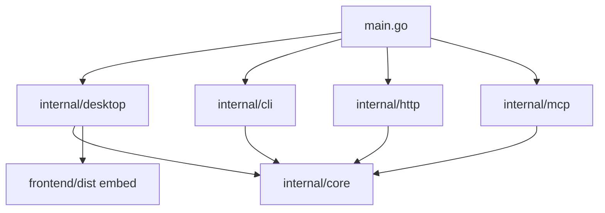

# Subtill scaffolding bootstrap

**Module:** `github.com/skarabasakis/subtill`  
**Brief:** [docs/prd/20261013-project-brief.md](docs/prd/20261013-project-brief.md)  
**Versions:** [`.tool-versions`](.tool-versions) — Go **1.25+**, Node 24.x; [`go.mod`](go.mod) `go` line matches asdf.

## Architecture



| Area | Bootstrap choice |
|------|------------------|
| Modes | Mutually exclusive: default Wails desktop, or `--cmd` / `--mcp` / `--api` |
| `--api` | JSON `/api/*` (bearer); Swagger UI `/swagger` (no bearer); no SPA |
| Desktop UI | Vite → `frontend/dist` → [`frontend/embed.go`](frontend/embed.go) → Wails only; Query → bindings |
| Core | `internal/core` + sqlx + `modernc.org/sqlite`; migrations in `internal/core/migrate/migrations/` |
| Workflows | [`Taskfile.yml`](Taskfile.yml) via **`wails3 task <name>`**; [`.vscode/tasks.json`](.vscode/tasks.json) wraps tasks only |
| Desktop E2E | Playwright vs Wails **server mode** (`-tags server`), `--config-path` per run ([brief](docs/prd/20261013-project-brief.md)) |
| Windows | Release build `windowsgui`; `--cmd`/`--mcp`/`--api` from shell → `internal/runtime/console.PrepareHeadless()` before stdio |

## Conventions

**`go.mod` `ignore` (Go 1.25+)** — keep `go test ./...` / gopls out of npm trees:

```go
ignore (
    ./frontend/node_modules
    ./e2e
)
```

**Embed:** `frontend/embed.go` → `//go:embed all:dist` (desktop only). SQL only from `internal/core/migrate/migrations/`. **`frontend/dist` gitignored** → task **`ensure:embeds`**: `mkdir -p frontend/dist` (cross-platform; add minimal `index.html` in same task only if empty `dist` breaks embed).

**Go tests:** Unit = `*_test.go` (`go test ./...`). Integration = `*_integration_test.go` with `//go:build integration`; **`test:integration`** = `go test -tags integration ./internal/http/... ./internal/mcp/...`. Wails **`server`** tag is for server-mode binaries only, not integration tests.

**Tooling:** golangci-lint v2 on PATH ([`.golangci.yml`](.golangci.yml) `version: "2"`); swag v2 via `go mod` **tool** + `go tool swag init --v3.1`; frontend/e2e npm: oxlint, oxfmt, vitest / Playwright.

## Target layout

```
subtill/
├── main.go, go.mod, go.sum, Taskfile.yml, build/
├── internal/
│   ├── core/{domain,service,store,migrate/migrations/}
│   ├── cli/, http/{doc.go,handlers/,docs/}, mcp/, desktop/
│   └── runtime/console/          # PrepareHeadless(); windows + stub
├── frontend/{embed.go,src/,bindings/,dist/}
├── e2e/{playwright.config.ts,tests/smoke.spec.ts}
├── .vscode/, .golangci.yml, AGENTS.md, README.md, docs/
```

## Phase 1 — Prerequisites

```bash
asdf install
go version    # >= 1.25
node --version
wails3 version && wails3 task -list
golangci-lint version
```

## Phase 2 — Wails init + Go skeleton

```bash
tmpdir=$(mktemp -d)
wails3 init -d "$tmpdir" -n subtill -t react \
  -mod github.com/skarabasakis/subtill \
  -productname subtill \
  -productdescription "Local subscription manager" -q
REPO_ROOT="$(git rev-parse --show-toplevel)"
rsync -av --exclude 'docs/' --exclude 'AGENTS.md' --exclude '.git/' \
  --exclude '.cursor/' --exclude '.tool-versions' \
  "$tmpdir/subtill/" "$REPO_ROOT/"
rm -rf "$tmpdir"
```

Then:

1. **`main.go`:** `--cmd` / `--mcp` / `--api` → `console.PrepareHeadless()` then adapter; else `internal/desktop.Run()`.
2. Remove demo GreetService; stub Wails services; wire `internal/desktop`.
3. **`go.mod`:** `go 1.25.4+` + **`ignore`** block (above).
4. **`frontend/embed.go`:** `//go:embed all:dist` → desktop only.
5. Migrations embedded under `internal/core/migrate/`.
6. `.gitignore`: `frontend/dist`, `bin/`, `node_modules`, e2e artifacts.

```bash
go get github.com/jmoiron/sqlx \
  github.com/golang-migrate/migrate/v4 \
  github.com/golang-migrate/migrate/v4/database/sqlite \
  github.com/modelcontextprotocol/go-sdk/mcp \
  modernc.org/sqlite \
  github.com/swaggo/http-swagger/v2@v2.0.3-0.20250902111949-1340604bd9f5
go get -tool github.com/swaggo/swag/v2/cmd/swag@v2.0.0-rc6
go mod tidy
```

**HTTP / OpenAPI:** `internal/http/doc.go` with `//go:generate go tool swag init --v3.1 -g doc.go -o docs ...`; mount `http-swagger/v2` at **`/swagger`**; bearer on **`/api/*`** only. Integration tests: health, `/swagger` without auth, spec `openapi` 3.1.0.

**Windows:** `console_windows.go` + stub; manual smoke after `wails3 task build`: `.\<wails-output>\subtill.exe --cmd list` prints to parent terminal.

```bash
cd frontend && npm install
```

## Phase 3 — Frontend + E2E

**Frontend**

1. React 19; shadcn init + sample button; `components/ui/` vs `components/primitives/`.
2. HashRouter, TanStack Query/Form/Table, recharts, lucide-react; `default-query-fn` → bindings.
3. Placeholder app shell + **`data-testid="app-shell"`** for Playwright.
4. `.oxlintrc.json`, `.oxfmtrc.json`, vitest (one component test); `npm run build` → `dist`.

**E2E** (`e2e/` — confirm `build:server` name via `wails3 task -list`)

```bash
mkdir -p e2e && cd e2e
npm init -y
npm install -D @playwright/test oxlint oxfmt typescript
npx playwright install chromium
```

- Mirror frontend oxlint/oxfmt; scripts `lint`, `fmt`, `fmt:check`.
- `playwright.config.ts`: `testDir: ./tests`; `webServer` via Taskfile if needed; pin `baseURL` after first run; `workers: 1`; `--config-path` via env.
- `smoke.spec.ts`: load app, assert `app-shell` visible.
- Document binary path, port, `webServer` command in README after first green `wails3 task e2e`.

## Phase 4 — Taskfile + VS Code tasks

Extend root [`Taskfile.yml`](Taskfile.yml) without breaking Wails `build/` includes.

| Task | deps | Commands |
|------|------|----------|
| `ensure:embeds` | — | `mkdir -p frontend/dist` |
| `lint` | ensure:embeds | golangci-lint; frontend + e2e `npm run lint` |
| `fmt` | ensure:embeds | golangci-lint fmt; frontend + e2e `npm run fmt` |
| `test` | ensure:embeds | `go test ./...`; frontend `npm run test:run` |
| `test:integration` | ensure:embeds | `go test -tags integration ./internal/http/... ./internal/mcp/...` |
| `openapi` | ensure:embeds | `go generate ./internal/http/...` |
| `e2e` | `build:server` | `cd e2e && npx playwright test` |

Optional: `check` → lint, test, test:integration.

**`.vscode/tasks.json`:** labels `subtill: lint|fmt|test|test (integration)|e2e|openapi|dev|build` → `wails3 task …`, `"cwd": "${workspaceFolder}"`.

## Phase 5 — Quality config + skeleton tests

- **`.golangci.yml`:** v2; linters govet, staticcheck, errcheck, unused, gosec; formatters gofmt, goimports. Swag `docs.go` skipped via generated header.
- **Tests:** `internal/core` unit; `internal/http` + `internal/mcp` integration-tagged as above.

## Phase 6 — VS Code workspace

**extensions.json — recommend:** `golang.go`, `golangci.golangci-lint`, `eriyc.wails-vscode-extension`, `bradlc.vscode-tailwindcss`, `oxc.oxc-vscode`, `vitest.explorer`, `ms-playwright.playwright`, `editorconfig.editorconfig`, `redhat.vscode-yaml`, `42crunch.vscode-openapi`, `qwtel.sqlite-viewer`, `github.vscode-github-actions`, `GARAIOAG.garaio-vscode-unwanted-recommendations`. **Unwanted:** `dbaeumer.vscode-eslint`, `esbenp.prettier-vscode`.

**settings.json:** leave **`go.testTags` unset**; `eslint.enable: false`; Tailwind `cn()` regex; `typescript.tsdk` → `frontend/node_modules/typescript/lib`; Go **1.25+** for gopls + `ignore`.

## Phase 7 — AGENTS.md

Pointers only (no duplicate essay): layout (`internal/core` + adapters); **`wails3 task`** + `ensure:embeds`; `go.mod` ignore; unit vs `integration` tests; OpenAPI `/swagger` vs `/api`; desktop-only UI; migrations path; bindings regen; E2E = Playwright server mode; Windows `PrepareHeadless()`.

## Phase 8 — README

Prerequisites, setup (`install:frontend:deps`, Playwright browsers), `wails3 task -list`, run modes, Taskfile commands, recorded **Wails build output path**, Windows console note for headless flags.

## Phase 9 — Verification

```bash
wails3 task install:frontend:deps
cd e2e && npx playwright install chromium   # once

wails3 task lint
wails3 task test
wails3 task test:integration
wails3 task openapi
wails3 task build
wails3 task e2e

# REST smoke — use binary from wails3 task build (record path in README)
# ./<wails-build-output>/subtill --api --port 8000 --token test &
# curl /swagger; curl /api/... with Authorization

wails3 task dev   # optional
```

**Windows (manual):** production-built `.exe --cmd list` from `cmd` with visible stdout.

## Out of scope

Product features, full REST/MCP parity, release CI, rich E2E beyond smoke, automated Windows CI for console attach.
