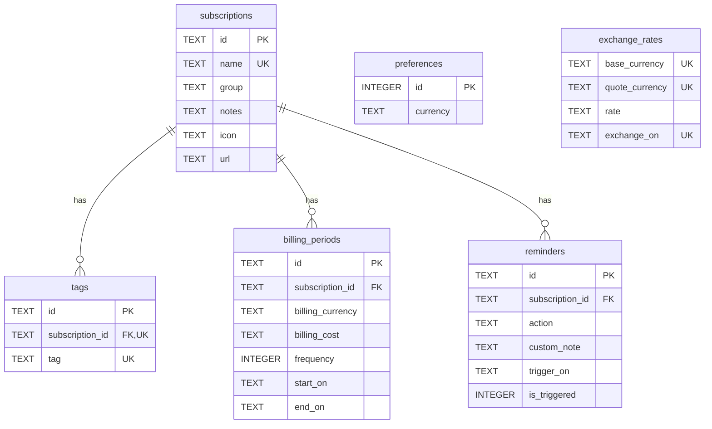

# Database Schema

## Data types

- **IDs**: `TEXT` primary keys, UUID v7 (generated in Go with `domain.NewID()`; empty IDs rejected by `CHECK (id <> '')`), except `preferences.id` (singleton row key).
- **Decimals**: stored as `TEXT` (`billing_cost`, `rate`). No decimal arithmetic in SQL; use `govalues/decimal` in Go.
- **Dates**: `TEXT` ISO 8601 calendar dates (`YYYY-MM-DD`) for `starts_on`, `end_on`, `trigger_on`, `exchange_on`.
- **Booleans**: SQLite `INTEGER` with values `0` or `1` (e.g. `is_triggered`).

## Global Constraints

- **Foreign keys**: enabled on every connection of the pool returned by `Open` (`foreign_keys(1)`). Pragmas are set in the connection string, never with `db.Exec`, because they apply per connection. Migrations run with foreign keys off. See [database package](../../internal/core/database/AGENTS.md#connections).
- **Journal mode**: WAL (`journal_mode(WAL)`), with `busy_timeout(5000)`, so the desktop app and an MCP, REST or CLI process can share the file.
- **Identity**: the SQLite header `application_id` is set to `SubtillAppID` (`0x53554254`) when the database is created, and checked when it is opened.
- **Case-insensitive strings**: `subscriptions.name` and `tags.tag` use `COLLATE NOCASE` where uniqueness is enforced.

## ER Diagram



## Tables

| Table | Role |
|-------|------|
| `subscriptions` | Core subscription metadata |
| `tags` | Tags attached to a subscription |
| `billing_periods` | Billing periods and cost in the billing currency |
| `reminders` | Pending reminders |
| `exchange_rates` | Dated FX cache, keyed by currency pair and date, used to convert billing costs to the preferred currency |
| `preferences` | Singleton database settings |

### `subscriptions`

```sql
CREATE TABLE subscriptions (
    id      TEXT NOT NULL PRIMARY KEY CHECK (id <> ''),           -- uuidv7
    name    TEXT NOT NULL COLLATE NOCASE UNIQUE,
    "group" TEXT,
    notes   TEXT,
    icon    TEXT,                                -- data URI of a 64×64 PNG, see icon service ADR
    url     TEXT
);
```

Reserved name warning: the `group` column must be quoted as `"group"` in the DDL.

### `tags`

```sql
CREATE TABLE tags (
    id              TEXT NOT NULL PRIMARY KEY CHECK (id <> ''),                                     -- uuidv7
    subscription_id TEXT NOT NULL REFERENCES subscriptions (id) ON DELETE CASCADE,
    tag             TEXT NOT NULL COLLATE NOCASE,
    UNIQUE (subscription_id, tag)
);
```

### `billing_periods`

```sql
CREATE TABLE billing_periods (
    id                        TEXT    NOT NULL PRIMARY KEY CHECK (id <> ''),                                        -- uuidv7
    subscription_id           TEXT    NOT NULL REFERENCES subscriptions (id) ON DELETE CASCADE,
    billing_currency          TEXT    NOT NULL,                                                    -- supported ISO 4217 code (e.g. USD, EUR)
    billing_cost              TEXT    NOT NULL,                                                    -- decimal string
    frequency                 INTEGER NOT NULL CHECK (frequency > 0),
    start_on                  TEXT    NOT NULL,                                                    -- YYYY-MM-DD
    end_on                    TEXT,                                                                -- YYYY-MM-DD
    CHECK (end_on IS NULL OR end_on > start_on)
);
```

### `reminders`

```sql
CREATE TABLE reminders (
    id                TEXT    NOT NULL PRIMARY KEY CHECK (id <> ''),                                        -- uuidv7
    subscription_id   TEXT    NOT NULL REFERENCES subscriptions (id) ON DELETE CASCADE,
    action            TEXT    NOT NULL CHECK (action IN ('cancel', 'renew', 'custom')),
    custom_note       TEXT,
    trigger_on        TEXT    NOT NULL,                                                    -- YYYY-MM-DD
    is_triggered      INTEGER NOT NULL DEFAULT 0 CHECK (is_triggered IN (0, 1))
);
```

Notes:
- Pending reminders only. Cleared reminders are deleted.
- custom_note is populated only when action is 'custom'
- Duplicate rows (same subscription, action, trigger_on) are allowed

### `exchange_rates`

```sql
CREATE TABLE exchange_rates (
    base_currency  TEXT NOT NULL, -- supported ISO 4217 code (e.g. USD, EUR) converted from
    quote_currency TEXT NOT NULL, -- supported ISO 4217 code (e.g. USD, EUR) converted to
    rate           TEXT NOT NULL, -- decimal string: units of quote_currency per 1 unit of base_currency
    exchange_on    TEXT NOT NULL, -- YYYY-MM-DD
    UNIQUE (base_currency, quote_currency, exchange_on),
    CHECK (base_currency <> quote_currency) -- the rate between identical currencies is always 1 and never cached
);
```

### `preferences`

```sql
CREATE TABLE preferences (
    id                 INTEGER PRIMARY KEY CHECK (id = 1), -- Singleton row key (`id = 1`).
    currency           TEXT    NOT NULL DEFAULT 'USD'
);
```

## Secondary Indexes

Limited number of secondary indexes created by default, since for a single-user desktop application, the number of rows is expected to be small. By default, we only create the following index to speed up the following frequently used queries:

```sql
-- SELECT * FROM subscriptions WHERE name = ?
CREATE INDEX ... ON subscriptions ("name");
-- SELECT * FROM billing_periods WHERE subscription_id = ?
CREATE INDEX ... ON billing_periods (subscription_id);
-- SELECT COUNT(*) FROM reminders WHERE trigger_on <= ?
CREATE INDEX ... ON reminders (trigger_on);
```

`exchange_rates` needs no extra index: its `UNIQUE (base_currency, quote_currency, exchange_on)` constraint creates an index that serves the cache lookup (`SELECT ... FROM exchange_rates WHERE base_currency = ? AND quote_currency = ? AND exchange_on IN (...)`) and the upsert conflict target.

If the number of rows grows, we could add secondary indexes to support subscription filtering as follows:

```sql
CREATE INDEX ... ON subscriptions ("group");
CREATE INDEX ... ON tags (subscription_id);
CREATE INDEX ... ON tags (tag);
```


## Out of scope for this schema

- `schema_migrations` and other metadata managed by `golang-migrate`.
- `schema_bootstrap` in early migrations (temporary scaffolding only).
