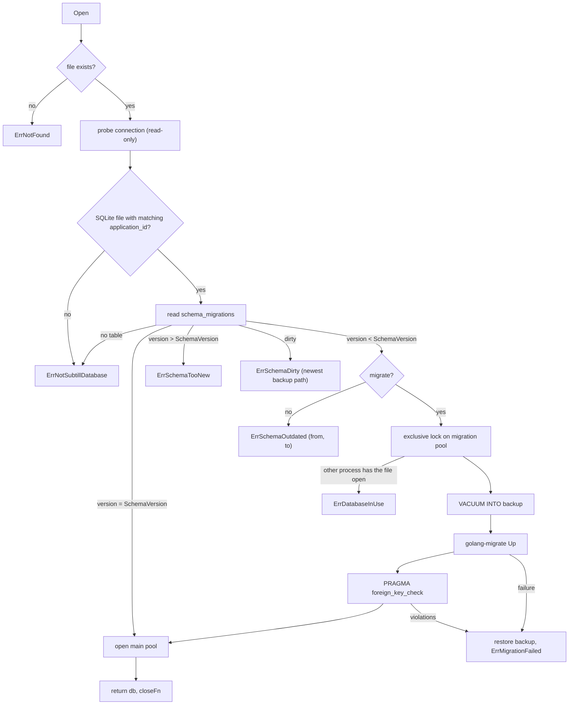

# DB Service

The db service creates, opens, migrates and closes subtill database files. It is the only code that opens SQLite connections; every other component receives the `*sqlx.DB` returned by `Open`.

## Dependencies

- Driver: `modernc.org/sqlite`
- Database access layer: `jmoiron/sqlx`
- Migrations library: `golang-migrate/migrate`

## Connection strings

The db service uses three kinds of connections:

| Connection | Connection string | Used for |
| --- | --- | --- |
| Probe | `file:<path>?mode=ro` | Identity and version checks in `Open`. Read-only and without pragmas, so checking a file never modifies it. |
| Main pool | `file:<path>?mode=rw&_pragma=foreign_keys(1)&_pragma=busy_timeout(5000)&_pragma=journal_mode(WAL)&_txlock=immediate` | The handle returned by `Open`. |
| Migration pool | `file:<path>?mode=rw&_pragma=busy_timeout(5000)&_pragma=journal_mode(WAL)&_pragma=locking_mode(EXCLUSIVE)&_txlock=immediate`, with `SetMaxOpenConns(1)` | `Create` and the migration step of `Open`. Foreign keys are off. |

- `mode=rw` makes opening a missing file fail instead of silently creating an empty database. Only `Create` creates files.
- `journal_mode(WAL)` and `busy_timeout(5000)` let the desktop app and an MCP, REST or CLI process use the same file at the same time. Readers don't block the writer, and a writer waits up to 5 seconds for another writer instead of failing immediately with `SQLITE_BUSY`.
- `_txlock=immediate` makes `BEGIN` take the write lock up front. A write transaction then waits for the lock at its start (where `busy_timeout` applies) instead of failing halfway through when a read lock can't be upgraded.

## Identity

Every subtill database has its SQLite header `application_id` set to `SubtillAppID` (`0x53554254`, ASCII `SUBT`). `Create` sets it. `Open` checks it before anything else, so a SQLite file that isn't a subtill database is never inspected through `golang-migrate`, never given a `schema_migrations` table and never migrated.

## Schema version

```go
var SchemaVersion uint
```

The version of the newest embedded migration. It is computed once at package initialization by walking the embedded `iofs` migration source with `First` and `Next`, so it can't drift from the files in `internal/core/migrate/migrations/`. An empty or unreadable embedded source is a build defect and panics at initialization.

The version of a database file is read with a plain `SELECT version, dirty FROM schema_migrations` on the probe connection, not through the `golang-migrate` driver. The driver creates `schema_migrations` if it doesn't exist and reports any read error as "no version".

## API

### Create

```go
func Create(path string, preferences Preferences) (err error)
```

Creates a new subtill database at `path` with the given preferences. The caller validates `preferences` with the same rules as `preferences.set`.

1. Creates the file with `os.OpenFile(path, os.O_RDWR|os.O_CREATE|os.O_EXCL, 0o600)` and closes it. Returns `ErrAlreadyExists` if the file exists. `O_EXCL` makes the existence check and the creation a single step, so two processes can't both create the file. A zero-byte file is a valid empty SQLite database.
2. Opens a migration pool and runs all embedded migrations, followed by `PRAGMA foreign_key_check` (see [Migration procedure](#migration-procedure)). No backup is taken, since there is nothing to back up.
3. Sets `PRAGMA application_id = SubtillAppID`.
4. Retrieves default preferences from OS locale. (A separate standalone service should handle this) and merges them with the passed preferences. Then upserts the singleton preferences row using the query from `PreferencesRepository.Upsert`. Can either call the repository method directly (if an sqlx connection is available) or directly execute the update statement through database/sql.
5. Closes the migration pool.

If any step fails, `Create` closes its connections and deletes `path`, `path-wal` and `path-shm` before returning the error, so a failed attempt can be retried.

`Create` doesn't return a handle. Callers open the new database with `Open(path, false)`.

### Open

```go
func Open(path string, migrate bool) (db *sqlx.DB, closeFn func() error, err error)
```

Opens the subtill database at `path` and returns the main pool and the function that closes it. If the schema is older than `SchemaVersion`, `Open` migrates it only when `migrate` is true. Otherwise it returns `ErrSchemaOutdated`.

On error, `db` and `closeFn` are nil and every connection `Open` opened is already closed.

```go
db, closeDB, err := dbservice.Open(path, migrate)
if err != nil {
    return err
}
defer closeDB()
```



1. Returns `ErrNotFound` if no file exists at `path`.
2. Opens the probe connection and reads `PRAGMA application_id`. Returns `ErrNotSubtillDatabase` if the file isn't a SQLite database or the id isn't `SubtillAppID`.
3. Reads `version` and `dirty` from `schema_migrations`, then closes the probe connection.
   - No `schema_migrations` table: `ErrNotSubtillDatabase`.
   - `dirty` is true: `ErrSchemaDirty`, with the path of the newest backup of this database, if any. This happens when a process crashed during a migration.
   - `version` is greater than `SchemaVersion`: `ErrSchemaTooNew`. The file was written by a newer subtill and this binary has no migrations to go back. The user has to upgrade subtill or restore a backup.
   - `version` is less than `SchemaVersion` and `migrate` is false: `ErrSchemaOutdated`.
   - `version` is less than `SchemaVersion` and `migrate` is true: runs the [migration procedure](#migration-procedure).
4. Opens the main pool, pings it and returns it with `closeFn`.

### GetInfo

```go
type DBInfo struct {
    SchemaVersion     uint              `json:"schemaVersion"`
    SubscriptionCount int               `json:"subscriptionCount"`
    Preferences       PreferencesRecord `json:"preferences"`
}

func GetInfo(db *sqlx.DB) (info *DBInfo, err error)
```

Returns the schema version, `SubscriptionCount` from `SubscriptionRepository.Count` on the main pool (see [repositories](20261022-repositories.md)), and the preferences row. It is only valid on a handle returned by `Open`, which guarantees the schema is current; it does not support older schemas.

## Closing

`closeFn` closes the main pool returned by `Open`:

1. Runs `PRAGMA wal_checkpoint(TRUNCATE)`, best effort; an error here is ignored. This copies the commits stored in `path-wal` into the database file. SQLite does this on its own only when the last connection to the file closes, so without it, commits made by this process would stay in `path-wal` for as long as another process (for example a long-running MCP server) keeps the file open. A user who copies or moves only the database file at that point loses those commits.
2. Calls `db.Close()` and returns its error.

`closeFn` is safe to call more than once; calls after the first return nil. Callers that keep the handle for a long time, such as the desktop app when it switches databases, store `closeFn` alongside the `*sqlx.DB`. Calling `db.Close()` directly skips the checkpoint and should not be done.

## Errors

| Error | Returned by | Meaning |
| --- | --- | --- |
| `ErrNotFound` | `Open` | No file exists at `path`. |
| `ErrAlreadyExists` | `Create` | A file already exists at `path`. |
| `ErrNotSubtillDatabase` | `Open` | The file is not a SQLite database, its `application_id` is not `SubtillAppID`, or it has no `schema_migrations` table. |
| `ErrSchemaOutdated` | `Open` | The schema is older than `SchemaVersion` and `migrate` is false. |
| `ErrSchemaTooNew` | `Open` | The schema is newer than `SchemaVersion`. |
| `ErrSchemaDirty` | `Open` | A previous migration was interrupted. |
| `ErrDatabaseInUse` | `Open` | The migration step could not take an exclusive lock because another connection has the file open. |
| `ErrMigrationFailed` | `Open`, `Create` | A migration or the foreign key check failed. In `Open`, the database was restored from the backup. |

The schema errors are wrapped in a `*SchemaError` that carries the details:

```go
type SchemaError struct {
    Err      error  // ErrSchemaOutdated, ErrSchemaTooNew, ErrSchemaDirty or ErrMigrationFailed
    Found    uint   // schema version of the file
    Expected uint   // SchemaVersion
    Backup   string // backup path, if one exists
}

func (e *SchemaError) Unwrap() error { return e.Err }
```

Callers use `errors.Is` for the kind of error and `errors.As` for the details. Adapters map them to their own behavior:

- CLI, MCP and REST: exit with an error. For `ErrSchemaOutdated` the message gives both versions and suggests `--db-migrate`. For `ErrSchemaDirty` and `ErrMigrationFailed` it gives the backup path.
- Desktop: for `ErrSchemaOutdated`, show a confirmation dialog that gives both versions and says a backup is taken first, then retry with `migrate = true`. Other errors are shown as messages.

## Migration procedure

Used by `Open` when `migrate` is true and the schema is outdated. `Create` runs steps 1, 4 and 5 only.

1. Open a migration pool. It is separate from the main pool and owned by the migration step, for two reasons:
   - Foreign keys are off. `golang-migrate` runs each migration file in a transaction, and `PRAGMA foreign_keys` is a no-op inside a transaction, so this is the only way to keep a table rebuild from cascading deletes (see [Authoring migrations](#authoring-migrations)).
   - `golang-migrate`'s `Close` closes the `*sql.DB` it was given. Since the migration step owns this pool, closing it is correct.
2. Take an exclusive lock with `BEGIN EXCLUSIVE; COMMIT;`. Because the pool uses `locking_mode(EXCLUSIVE)`, the connection keeps the lock until it closes. In WAL mode every open connection holds a shared lock on the file, so if another process has the database open, this fails after `busy_timeout` and `Open` returns `ErrDatabaseInUse`. The schema is never changed while another process is using it.
3. Back up the database with `VACUUM INTO '<path>.<YYYYMMDDTHHMMSS>.v<from>.bak'`. This writes a consistent copy that includes commits still in `path-wal`.
4. Run `golang-migrate` `Up` on the migration pool. `ErrNoChange` is not an error.
5. Run `PRAGMA foreign_key_check`. Any returned row fails the migration.
6. Close the migration pool.

If step 4 or 5 fails, the migration step closes the migration pool, deletes `path-wal` and `path-shm`, copies the backup to a temporary file next to `path` and renames it over `path`, then returns `ErrMigrationFailed` with the backup path. This matters because `golang-migrate` marks the version as dirty before running each file and leaves it dirty if the file fails, and because an upgrade across several versions is not atomic: each file is committed separately. Restoring the backup returns the database to the exact state it was in before `Open` was called.

Backups are kept after a successful migration. The db service never deletes them.

## Authoring migrations

Migrations live in `internal/core/migrate/migrations/` and are created with `wails3 task migrate:create`.

- Each file runs in its own transaction with foreign keys off. Do not write `BEGIN`, `COMMIT` or `PRAGMA foreign_keys` statements in migration files.
- Column changes that `ALTER TABLE` can't express use SQLite's table-rebuild pattern: create `new_<table>`, copy the rows, drop `<table>`, rename `new_<table>` to `<table>`, then recreate its indexes. This is safe because foreign keys are off, so dropping a referenced table does not cascade.
- Every migration must leave the database passing `PRAGMA foreign_key_check`, otherwise the migration fails and the backup is restored.
- Down migrations are kept for development with the `migrate` CLI. subtill never runs them.

## Testing

### Principles

- **Real files.** Tests work on real database files in `t.TempDir()`, never `:memory:`. The behavior under test is file-based: `mode=rw`, the probe connection, WAL sidecar files, locks, backups and the rename on restore.
- **Part of the unit suite.** The tests run in `wails3 task test` (plain `go test ./...`, no `integration` tag), so each test stays well under a second.
- **Check the disk, not just the error.** Every failure case also checks that the file was left as described: unchanged bytes, no `-wal` or `-shm` files, no backup file and no connections left open.

### Test seam

The public functions are thin wrappers over unexported functions that take a config:

```go
type config struct {
    migrations  fs.FS         // embedded migrations in production
    busyTimeout time.Duration // 5s in production
}
```

`SchemaVersion` is derived from `config.migrations` in the same way as in production.

- Tests that only need the embedded migrations live in the external `_test` package and call the public API.
- Tests for migration paths live in an internal test file and pass an `fstest.MapFS` of synthetic migrations: two or more versions, a failing file, a file that leaves a foreign key violation, and a table rebuild of a parent table. They also set a short busy timeout, so the "database in use" case doesn't wait 5 seconds. Until the embedded source has more than one real migration, the outdated and failing paths can only be tested this way.

### Helpers

- `rawDB(t, path)`: opens the file without going through the db service, to set up states such as a different `application_id`, a changed `version` or `dirty` flag, or seeded rows.
- `digest(t, path)`: the file's SHA-256, used to assert that a file is unchanged.
- `assertNoSidecars(t, path)`: asserts that neither `path-wal` nor `path-shm` exists.
- `assertNoOpenConnections(t, path)`: opens a fresh connection with `locking_mode(EXCLUSIVE)` and no busy timeout, and asserts that `BEGIN EXCLUSIVE` succeeds immediately. This proves the db service closed every connection it opened, which is the "on error, every connection is closed" guarantee. It matters most on Windows, where an open handle prevents renaming and deleting the file.

### Cases

`**SchemaVersion**`

- Equals the highest version among the embedded `*.up.sql` files, computed independently in the test by globbing the file names.

`**Create**`

- On success, every resulting property is checked: `application_id` is `SubtillAppID`, the version is `SchemaVersion` and not dirty, the preferences row matches the input, the journal mode is WAL, the file mode is `0600` (skipped on Windows), and `Open(path, false)` then succeeds.
- An existing file returns `ErrAlreadyExists`, and its digest is unchanged.
- A missing parent directory returns an error and creates nothing.
- Concurrent `Create` calls on the same path: exactly one succeeds and the others return `ErrAlreadyExists`.
- A failing migration, or one that leaves a foreign key violation, returns `ErrMigrationFailed`, removes the file and its sidecars, and a retry with valid migrations succeeds.

`**Open`, refusals.** Each case asserts the error with `errors.Is`, the `*SchemaError` details (`Found`, `Expected`, `Backup`) with `errors.As` where they apply, nil `db` and `closeFn`, an unchanged digest, no sidecars and no open connections.

- A missing file returns `ErrNotFound`, and no file is created at `path`. This is the regression test for `mode=rw`.
- A text file, a file of random bytes, a SQLite file with a different `application_id`, and a file with `SubtillAppID` but no `schema_migrations` table all return `ErrNotSubtillDatabase`. The foreign SQLite file is not given a `schema_migrations` table.
- A newer version returns `ErrSchemaTooNew`, also when `migrate` is true.
- A dirty version returns `ErrSchemaDirty`, with `Backup` set to the newer of two backup files, or empty when there is no backup.
- An outdated version with `migrate` false returns `ErrSchemaOutdated` and creates no backup.

`**Open`, success and migration**

- A current schema returns a working pool. The test holds several connections at once with `db.Conn` and checks `foreign_keys = 1`, the busy timeout and `journal_mode = wal` on each one. This is the regression test for pragmas being set on every connection of the pool.
- An outdated schema with `migrate` true is migrated to `SchemaVersion` and keeps its seeded rows. A backup named `<path>.<YYYYMMDDTHHMMSS>.v<from>.bak` exists and opens at the old version with the old data.
- When the second of two pending migrations fails, or a migration leaves a foreign key violation, `Open` returns `ErrMigrationFailed` with `Backup` set. The file's bytes equal the backup's, there are no sidecars, and the file is at its original version and not dirty. A following `Open(path, false)` returns `ErrSchemaOutdated`, not `ErrSchemaDirty`.
- A table-rebuild migration of a parent table keeps the rows of its child tables. This proves foreign keys are off during migrations and is the regression test for cascading deletes.
- When another connection holds the outdated file open, `Open` returns `ErrDatabaseInUse`, creates no backup and leaves the digest unchanged. A second connection in the same process is enough, because SQLite tracks locks per file across all connections of a process.

`**closeFn**`

- The test writes a row while a second connection keeps the file open, so that SQLite doesn't checkpoint on its own. After `closeFn`, it copies only the database file to another directory and opens the copy: the row must be there. This tests the guarantee users depend on rather than the pragma call.
- A second call returns nil, and the pool is closed (`Ping` fails).

`**GetInfo**`

- On a fresh database it returns `SchemaVersion`, a subscription count of 0 and the preferences passed to `Create`.
- After rows are inserted, the count matches.
- On a closed pool it returns an error.

### Upgrades from released schema versions

When a release ships a new schema version, a seeded fixture `testdata/v<N>.db` created by that release is committed. It contains subscriptions with tags, several billing periods, reminders and exchange rates. Committed fixtures are never regenerated or edited. A table-driven test copies each fixture into `t.TempDir()`, runs `Open(copy, true)` and checks that the migration succeeds, `PRAGMA foreign_key_check` is clean and row counts are preserved. This covers the upgrade path real users take, which synthetic migrations can't. The list is empty until a second schema version exists.

### Platforms

The db service tests run on Windows as well as macOS and Linux. Replacing the file on restore, deleting files, sidecar handling and file modes all behave differently on Windows.

## Open questions

- **Backup retention.** Each migration adds a backup file next to the database and nothing removes them.
