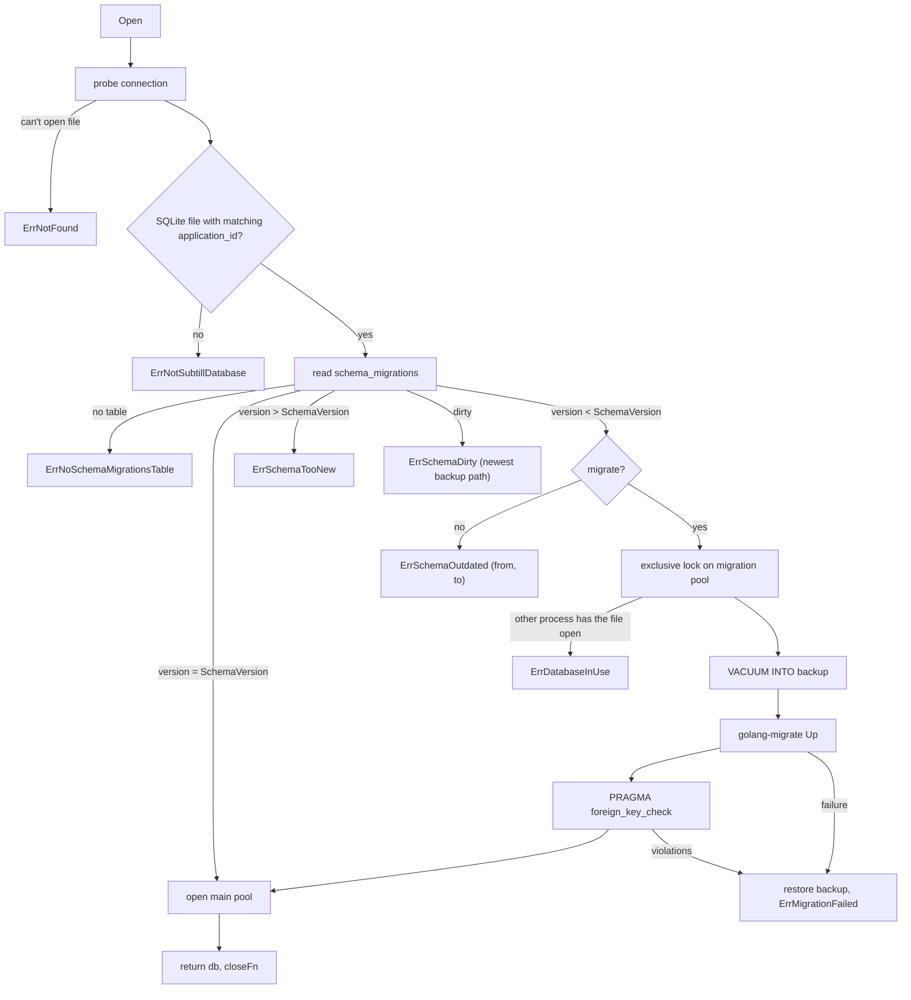

# database package

Rules for changing `internal/core/database`. Run `go doc -all ./internal/core/database` for the API.

## Scope

This package creates, opens, migrates and closes subtill database files. It is the only code that opens SQLite connections; every other component receives the `*sqlx.DB` returned by `Open`. It uses `modernc.org/sqlite`, `jmoiron/sqlx` and `golang-migrate/migrate`.

## Public API shape

- The package-level `Create`, `Open`, `Info` and `SchemaVersion` delegate to the unexported `defaultService`, built from the embedded migrations with a 5s busy timeout. Never export it or make it reassignable: no caller may change the schema the program runs against.
- `New` and `WithBusyTimeout` exist to inject a different migration source. In practice that is tests only.
- `SchemaVersion` is always derived from the migration source by `latestVersion`, which walks it with `First`/`Next` like golang-migrate does. Never hard-code it. An empty embedded source is a build defect, so `mustNew` panics at init.

## Connections

The exact connection strings are in [dsn.go](dsn.go).

| Connection | Used for | Notes |
| --- | --- | --- |
| Probe | Identity and version checks in `Open` | Runs no writes and no pragma that changes the file. |
| Main pool | The handle returned by `Open` | Foreign keys on, WAL, busy timeout, `_txlock=immediate`. |
| Migration pool | `Create` and the migration step of `Open` | Foreign keys off, `locking_mode(EXCLUSIVE)`, `SetMaxOpenConns(1)`. |

- Set pragmas in the connection string, never with `db.Exec`. Pragmas apply per connection, and a pool opens connections on its own.
- Every connection uses `mode=rw`, so opening a missing file fails instead of creating an empty database. Only `Create` creates files, with `O_EXCL`.
- The probe is read-write only so that, as the last connection to a WAL database, closing it removes the `-wal` and `-shm` files it had to create. A `mode=ro` connection creates them too but can't remove them.
- WAL and `busy_timeout` let the desktop app and an MCP, REST or CLI process share the file: readers don't block the writer, and a writer waits for another writer instead of failing with `SQLITE_BUSY`.
- `_txlock=immediate` makes `BEGIN` take the write lock up front, where `busy_timeout` applies, instead of failing halfway through a transaction when a read lock can't be upgraded.

## Identity and version checks

- Every subtill database has its header `application_id` set to `SubtillAppID` (`0x53554254`, ASCII `SUBT`). `Open` checks it before anything else.
- Never run golang-migrate on a file that hasn't passed the identity check. Its sqlite driver creates `schema_migrations` if it's missing and reports read errors as "no version", which would modify or misreport a foreign file.
- On the probe, read the version with a plain `SELECT version, dirty FROM schema_migrations`, after checking that the table exists. golang-migrate's `Version` is used only under the migration lock.
- golang-migrate reads the migration files, applies them in order, each in its own transaction, and records the version. This package adds what it lacks:
  - the identity and version checks above;
  - a lock across processes (the driver's `Lock` only excludes migrations in the same process);
  - the backup and its restore on failure;
  - `PRAGMA foreign_key_check` after migrating;
  - typed errors for dirty and too-new schemas, returned before any lock or backup.

## Open

`Service.Open` is the orchestrator: every check is called from it, and the helpers return only errors (see "Code Style Preferences" in the root [AGENTS.md](../../../AGENTS.md)). On error, `db` and `closeFn` are nil and every connection `Open` opened is closed.

- `SQLITE_CANTOPEN` maps to `ErrNotFound`: the file or its directory doesn't exist, it is a directory, or it can't be read. Don't add an `os.Stat` before opening.
- A file that isn't SQLite fails when the probe is pinged, with `SQLITE_NOTADB`. Map that to `ErrNotSubtillDatabase`.
- The probe is closed before the migration pool opens.

## Create

1. Create the file with `os.OpenFile(path, O_RDWR|O_CREATE|O_EXCL, 0o600)`, so two processes can't both create it. A zero-byte file is a valid empty SQLite database.
2. Run all migrations and `foreign_key_check` on a migration pool. No backup, since there is nothing to back up.
3. Set `PRAGMA application_id`.
4. Store `preferences.AppliedTo(locale.DefaultPreferences())` with `PreferencesRepository.Upsert`.

If any step fails, remove `path`, `path-wal` and `path-shm`, so a failed attempt can be retried. `Create` returns no handle; callers then call `Open(path, false)`.

## Migration procedure

Used by `Open` when `migrate` is true and the schema is outdated. Keep these steps and their order.

1. Open a migration pool, separate from the main pool. Foreign keys must be off: golang-migrate runs each file in a transaction, where `PRAGMA foreign_keys` is a no-op, so this is the only way to keep a table rebuild from cascading deletes. golang-migrate's `Close` closes the `*sql.DB` it was given, which is right because the migration step owns this pool.
2. Take an exclusive lock with `BEGIN EXCLUSIVE; COMMIT;`. With `locking_mode(EXCLUSIVE)` the connection keeps it until it closes. In WAL mode every open connection holds a shared lock, so if another process has the file open, this fails after `busy_timeout` and `Open` returns `ErrDatabaseInUse`. Never change the schema while another process is using it.
3. Re-read the version with golang-migrate's `Version` under the lock, since another process may have migrated the file after the probe. Apply the same checks, and stop without a backup if the schema is already current.
4. Back up with `VACUUM INTO '<path>.<YYYYMMDDTHHMMSS>.v<from>.bak'`. This writes a consistent copy that includes commits still in `path-wal`.
5. Run `Up`. `ErrNoChange` is not an error.
6. Run `PRAGMA foreign_key_check`. Any row fails the migration.
7. Close the migration pool.

If step 5 or 6 fails, close the pool, delete `path-wal` and `path-shm`, copy the backup to a temp file next to `path`, rename it over `path`, and return `ErrMigrationFailed` with the backup path. This is needed because golang-migrate leaves a failed file dirty, and an upgrade across several versions commits each file separately.

Never delete backups. They are kept after a successful migration too.

## Closing

- Callers close the pool with `closeFn`, never `db.Close()`.
- `closeFn` runs `PRAGMA wal_checkpoint(TRUNCATE)` (best effort, errors ignored) and then `db.Close()`. SQLite checkpoints on its own only when the last connection closes, so without this, commits would stay in `path-wal` for as long as another process keeps the file open, and a user who copies only the database file would lose them.
- `closeFn` must be safe to call more than once; later calls return nil.

## Errors

Return the sentinels in [errors.go](errors.go). Schema errors are wrapped in a `*SchemaError` carrying `Found`, `Expected` and `Backup`; callers use `errors.Is` for the kind and `errors.As` for the details.

| Error | Returned by | Meaning |
| --- | --- | --- |
| `ErrNotFound` | `Open` | The file doesn't exist or can't be opened. |
| `ErrAlreadyExists` | `Create` | A file already exists at `path`. |
| `ErrNotSubtillDatabase` | `Open` | Not SQLite, or its `application_id` isn't `SubtillAppID`. |
| `ErrNoSchemaMigrationsTable` | `Open` | The `application_id` is `SubtillAppID`, but there is no `schema_migrations` table. |
| `ErrSchemaOutdated` | `Open` | Older than `SchemaVersion` and `migrate` is false. |
| `ErrSchemaTooNew` | `Open` | Newer than `SchemaVersion`; this binary can't go back. |
| `ErrSchemaDirty` | `Open` | A previous migration was interrupted. `Backup` is the newest backup, if any. |
| `ErrDatabaseInUse` | `Open` | The migration lock failed because another connection has the file open. |
| `ErrMigrationFailed` | `Open`, `Create` | A migration or the foreign key check failed. `Open` has restored the backup. |

Adapters map them: CLI, MCP and REST exit with an error that gives both versions and suggests `--db-migrate` for `ErrSchemaOutdated`, and the backup path for `ErrSchemaDirty` and `ErrMigrationFailed`. The desktop app asks for confirmation on `ErrSchemaOutdated`, saying a backup is taken first, then retries with `migrate = true`.

## Authoring migrations

Migrations live in `internal/core/database/migrations/` and are created with `wails3 task migrate:create`.

- Each file runs in its own transaction with foreign keys off. Don't write `BEGIN`, `COMMIT` or `PRAGMA foreign_keys` in migration files.
- For column changes `ALTER TABLE` can't express, rebuild the table: create `new_<table>`, copy the rows, drop `<table>`, rename `new_<table>` to `<table>`, then recreate its indexes. This is safe because foreign keys are off.
- Every migration must leave the database passing `PRAGMA foreign_key_check`, or the migration fails and the backup is restored.
- Down migrations are for development with the `migrate` CLI. subtill never runs them.

## Testing

Principles:

- Use real files in `t.TempDir()`, never `:memory:`. The behavior under test is file-based.
- The tests run in `wails3 task test` without a build tag, so each one stays well under a second.
- Check the disk, not just the error. Failure cases also assert unchanged bytes (`Digest`), no sidecars (`AssertNoSidecars`), no backup and no open connections (`AssertNoOpenConnections`).

Layout:

- All tests are external (`package database_test`) and use the public API. Tests that need other migrations build a `Service` with `New(migrationsFS(...), WithBusyTimeout(100*time.Millisecond))` through the `newService` fixture.
- Raw SQLite helpers live in `helpers_test.go` and are exported to the external tests through `export_test.go`. Those are the only internal test files.
- Tests sit in the file of the feature they cover: `create_test.go`, `open_test.go`, `migration_test.go`, `info_test.go`, `service_test.go`.

Keep these regression cases:

- `Open` on a missing file creates nothing (`mode=rw`).
- A foreign SQLite file is not given a `schema_migrations` table.
- Every connection of the main pool has foreign keys on, the busy timeout and WAL. Check several connections held at once.
- Too-new, dirty (with the newest backup) and outdated schemas are refused with the right `*SchemaError` details and leave the file unchanged.
- An outdated schema with `migrate` true keeps its rows and leaves a backup that opens at the old version.
- A failing migration or a foreign key violation restores the file byte for byte, leaves it at the old version and not dirty, and a following `Open(path, false)` returns `ErrSchemaOutdated`.
- A table rebuild of a parent table keeps the child rows (foreign keys off during migrations).
- Migrating while another connection holds the file returns `ErrDatabaseInUse` and creates no backup.
- After `closeFn`, a copy of the database file alone contains the last commit, even while another connection keeps the file open.
- Concurrent `Create` calls: exactly one succeeds. A failed `Create` leaves no files behind.

When a release ships a new schema version, commit a seeded fixture `testdata/v<N>.db` from that release and never edit it. A table-driven test copies each fixture, runs `Open(copy, true)` and checks that the migration succeeds, `foreign_key_check` is clean and row counts are preserved. The list is empty until a second schema version exists.

The tests must pass on Windows too. Rename on restore, file deletion, sidecars and file modes all behave differently there.

## Open questions

- Backup retention: each migration adds a backup next to the database and nothing removes them.
